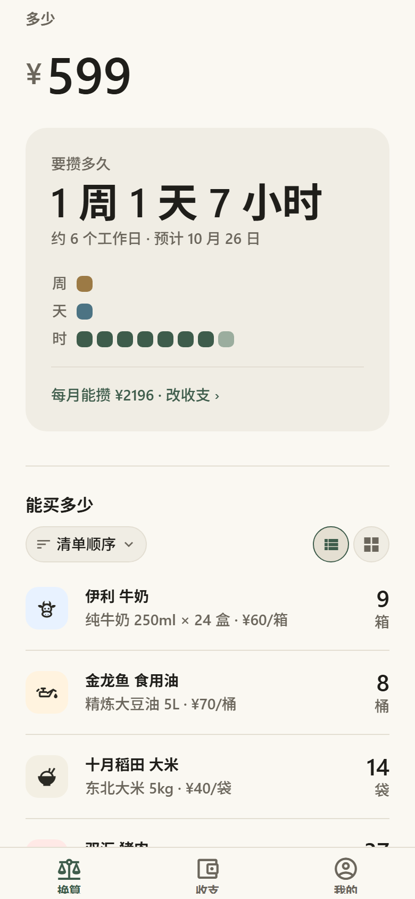
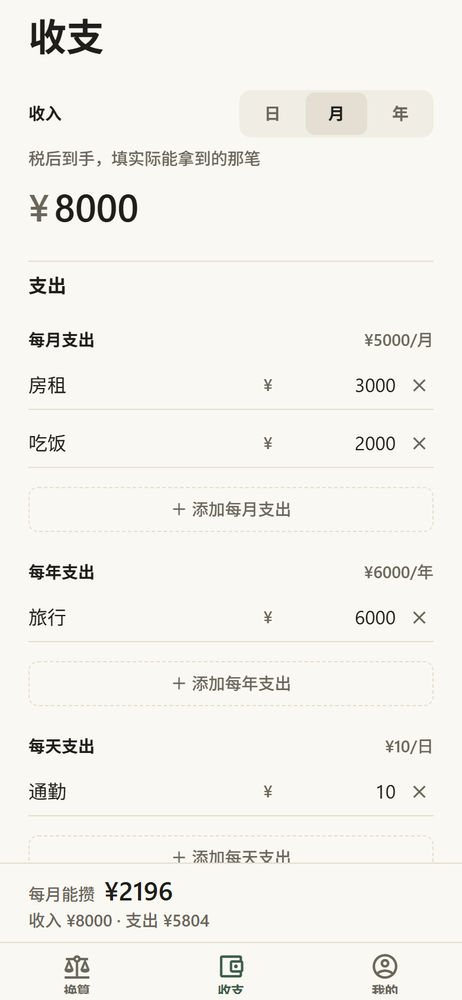
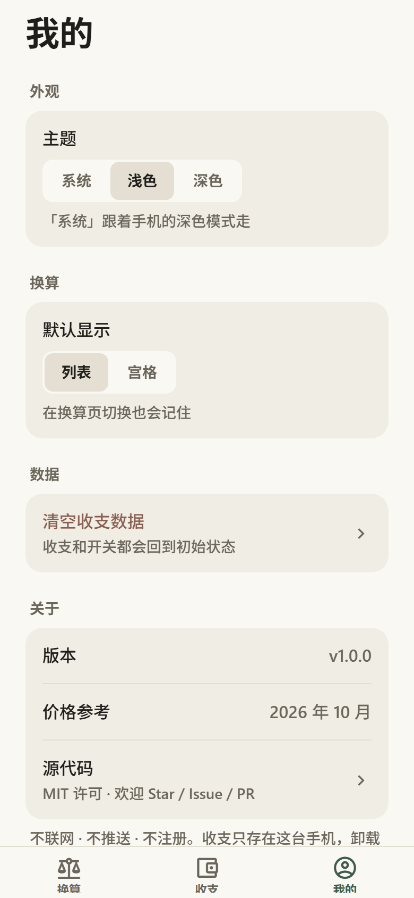

# 多少 · moreless

> More of what matters. Less of what doesn't.

[](https://github.com/YukieUdon/moreless/actions/workflows/ci.yml)
[](LICENSE)


「多少」有两层意思：一层是 **how much**（多少钱、多少件），另一层是 **什么该多、什么该少**——清楚自己真正需要的是多少。工程名 `moreless` 就是这两层意思的合写。

> 不注册、不联网、不推送。数据只存在你自己的设备上。

<p align="center">
  
  
  
</p>

## 现在有什么

底部三个 tab：

- **换算**：输一个金额，同一页先看「要攒多久」（按你填的收支算），再看「能买多少」（牛奶 / 大米 / 猪肉……），可以按列表或宫格看。
- **收支**：收入按日 / 月 / 年填；支出按项记，每项也能选日 / 月 / 年（房租 3000/月、旅行 6000/年、通勤 10/天）。改完自动保存，只存本机。
- **我的**：主题（跟随系统 / 浅色 / 深色）、换算页默认显示、清空收支、版本和价格参考月份。

还在路上的小工具：「冷静一下」「不花钱的快乐」。所有功能都会遵守同一条底线：**不制造焦虑，不增加任务**。

## 在自己的手机上打开

环境要求：

- **Node.js 22**（见 `.nvmrc`；React Native 0.86 也支持 20.19.4+ / 24+）
- npm（项目固定用 npm，不用 pnpm / yarn）
- 手机装 **Expo Go**，版本要匹配 **Expo SDK 57**（当前测试版本 57.0.9）

```bash
git clone https://github.com/YukieUdon/moreless.git
cd moreless
npm install
npx expo start
```

手机和电脑连同一个 Wi-Fi，用 Expo Go 扫终端里的二维码。之后改代码保存，手机和浏览器都会自动刷新。

不想用手机时，直接在浏览器里看：

```bash
npx expo start --web
```

Windows 用户也可以双击仓库根目录的 `启动.bat`（首次自动装依赖）或 `预览.bat`（自动起服务并打开浏览器）。

> 在中国大陆直连 npm 官方源很慢时，可以把 `.npmrc.example` 复制成 `.npmrc`，取消镜像那一行的注释。`.npmrc` 已被 gitignore，不会提交。

## 常用命令

| 动作 | 命令 |
|---|---|
| 手机预览 | `npm start` → Expo Go 扫码 |
| 浏览器预览 | `npm run web` |
| 类型检查 | `npm run typecheck` |
| 单元测试 | `npm test` |
| Lint | `npm run lint` |
| 截图自查 | `npm run screenshots`（产物在 `.shots/`） |
| 依赖体检 | `npx expo-doctor` |
| 安卓安装包 | `npx eas build -p android --profile preview` |
| iOS 上架包 | `npx eas build -p ios --profile production` |

装原生依赖一律用 `npx expo install <包>`，不要用 `npm install <包>`——前者会挑和 SDK 匹配的版本。每次改完至少跑一次 `npm run typecheck`。

## 工程质量

- **TypeScript strict** + **ESLint** + **Vitest**；`npm run typecheck` / `npm test` / `npm run lint` 三项全绿才算改完。
- **`src/core` 是纯逻辑**，不依赖 React / Expo，规则可以单独测试，由 Vitest 覆盖。
- **GitHub Actions** 在每次 push / PR 到 `main` 时跑完整检查，见 [`.github/workflows/ci.yml`](.github/workflows/ci.yml)。
- **UI 改动要能看见**：附一张 `npm run screenshots` 的截图，并在 PR 里写「在哪个页面看什么」。
- 提交前先读 [`CONTRIBUTING.md`](CONTRIBUTING.md)，尤其是预览、截图和产品红线。

## 数据与隐私

- 收支存 AsyncStorage `ml_plan_v2`，设置存 `ml_settings_v1`，都只在本机。
- 不注册、不登录、不收集个人信息、不接广告 / 统计 / 崩溃上报 SDK、不申请通知和定位权限。
- Android 发布包不申请 INTERNET、外部存储、悬浮窗、震动权限。
- 发布包不发起业务网络请求；用 Expo Go 开发时连接 Metro 是开发工具的行为。
- 唯一的对外动作是「我的 → 源代码」用系统浏览器打开 GitHub；由你主动点击，不会带任何本地数据。
- 删除：`我的 → 清空收支数据`，或者直接卸载 App。

完整说明见 [`docs/隐私.md`](docs/隐私.md)。

## 目录

| 路径 | 放什么 |
|---|---|
| `src/app/` | 页面，文件名就是路由 |
| `src/core/` | 判断逻辑（不依赖 react / expo，可单独测试） |
| `src/components/` | 可复用组件 |
| `src/constants/theme.ts` | 颜色、字号、间距 |
| `src/hooks/` | 主题、偏好、收支数据 Provider |
| `src/lib/` | 存储、格式化、平台适配 |
| `src/data/` | 换算用的默认物品清单 |
| `scripts/` | 图标生成、网页截图 |
| `docs/` | 隐私说明、Expo 版本纪律、README 截图 |

判断逻辑必须落在 `src/core/`，界面只负责展示。这个 App 的价值在规则本身——规则能单独测试，改界面时才不会悄悄改坏算法。

## Fork / 自己打包

官方包身份是 `app.moreless.mobile`，scheme 是 `moreless`。Fork 后请改掉，否则会和官方包冲突：

```bash
ML_APP_ID=dev.example.moreless ML_SCHEME=morelessdev npx expo start
```

也可以直接改 `app.json`。动态配置在 `app.config.js`，环境变量默认不生效，只有显式设置时才覆盖。

打包用 EAS：

```bash
npx eas init          # 第一次，把项目绑到你的 Expo 账号
npx eas build -p android --profile preview
```

`eas.json` 里 `preview` 出 APK，`production` 用于商店包。不要把别人的 `projectId` 硬编码进仓库。

## 设计原则

这个项目刻意保持小。功能取舍看 `AGENTS.md` 的「产品态度」和「红线」：

- 不做账号墙，首次打开即可用全部工具。
- 本地优先；引入云端必须先回答「离线还能不能用」。
- 不做焦虑型增长：没有排名、没有断签惩罚、没有「你已经 N 天…」。
- 不卖情绪：不靠制造焦虑变现，不接诱导消费的广告。

## 价格与品牌说明

换算清单里的品牌、型号和价格只用于说明规格，价格是 2026 年 10 月的常见零售参考值，不是实时报价，也不代表任何品牌合作或背书。清单在 `src/data/items.ts`，欢迎提 PR 更新。

## 参与贡献

- 贡献指南：[`CONTRIBUTING.md`](CONTRIBUTING.md)
- 行为准则：[`CODE_OF_CONDUCT.md`](CODE_OF_CONDUCT.md)
- 安全报告：[`SECURITY.md`](SECURITY.md)（请不要公开披露漏洞细节）

第一次贡献不需要签 CLA；按 MIT 许可提交即可。

## 版本记录

当前版本 `1.0.0`。变更记录见 [`CHANGELOG.md`](CHANGELOG.md)。

## 许可证

代码以 [MIT](LICENSE) 许可发布，版权归 © 2026 YukieUdon。

MIT 只覆盖代码。名称「多少 / moreless」、wordmark `more.less` 和图标不随代码许可授权；Fork 请换名字和图标，不要让人误以为是官方版本。

项目从 Expo 官方应用模板起步，模板的 MIT 声明保留在 [`THIRD_PARTY_NOTICES.md`](THIRD_PARTY_NOTICES.md)。

## 致谢

- [Expo](https://expo.dev) / [React Native](https://reactnative.dev) / [Expo Router](https://docs.expo.dev/router/introduction/)
- [Material Design Icons](https://materialdesignicons.com)（`@expo/vector-icons`）
- 所有提 Issue、PR 和想法的人
